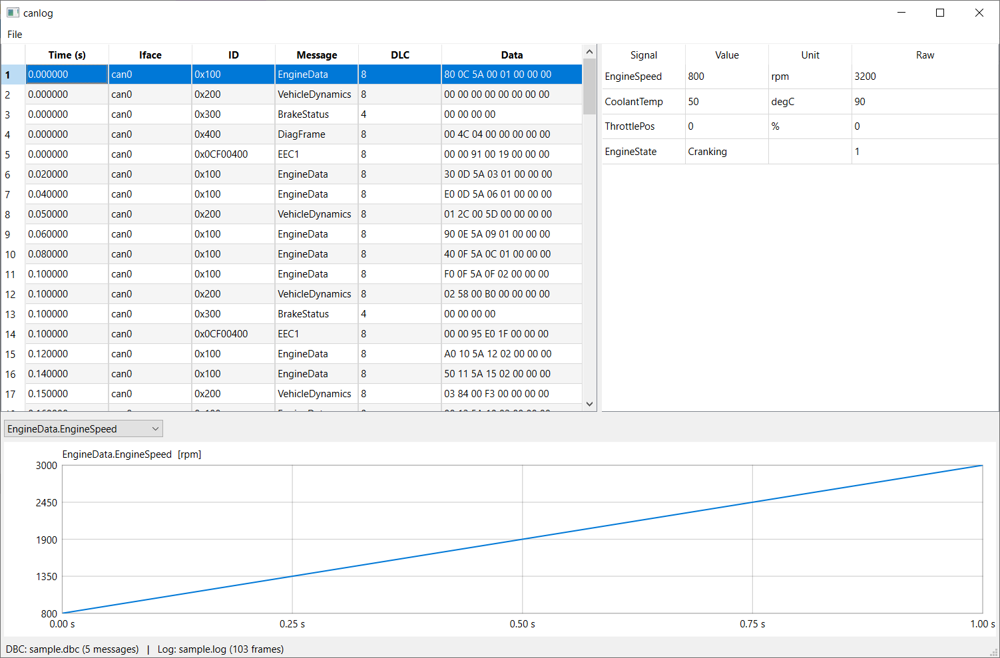
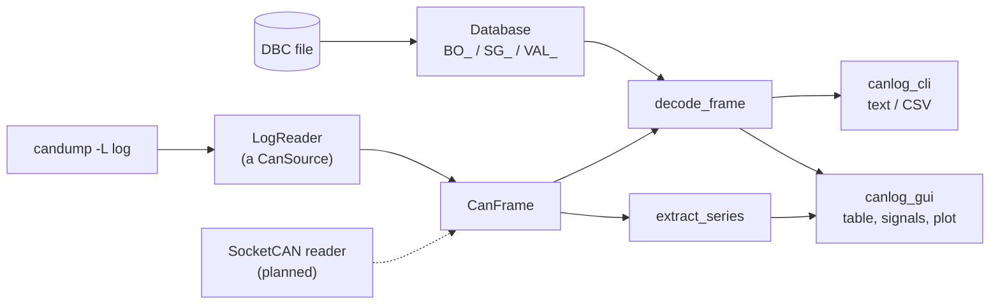

# canlog

   [](https://github.com/amrfouda/canlog/actions/workflows/build.yml)

   

A C++17 library, CLI and Qt 6 GUI that decode CAN logs using DBC files.
Live capture over SocketCAN is next on the roadmap.

```
$ canlog_cli --dbc data/sample.dbc --log data/sample.log
    0.000s  can0   0x100      EngineData   EngineSpeed=800 rpm  CoolantTemp=50 degC  ThrottlePos=0 %  EngineState=Cranking
    0.050s  can0   0x200      VehicleDynamics   VehicleSpeed=3 km/h  SteeringAngle=9.3 deg
    ...
```

## Build and run

```bash
cmake -S . -B build -G Ninja          # or omit -G Ninja for Makefiles
cmake --build build
ctest --test-dir build --output-on-failure
./build/canlog_cli --dbc data/sample.dbc --log data/sample.log
./build/canlog_cli --dbc data/sample.dbc --log data/sample.log --message BrakeStatus --csv brake.csv
```

Requires a C++17 compiler and CMake 3.16+. The core library has no dependencies
and builds on Linux, macOS and Windows; only the future SocketCAN reader is Linux-only.

## Qt GUI (optional)

`canlog_gui` shows the capture as a trace table, the decoded signals of the selected
frame, and a plot of any signal over time. It is built only when Qt 6 is found.

**Prebuilt Windows binaries:** see the latest run in the
[Actions tab](https://github.com/amrfouda/canlog/actions) (artifact `canlog-windows`),
or the [Releases page](https://github.com/amrfouda/canlog/releases) once a release exists.

1. Install Qt 6 (Qt Online Installer, free Qt account) and tick the **MSVC 64-bit** kit
   for your Visual Studio, e.g. `C:\Qt\6.7.2\msvc2019_64`.
2. Point CMake at it and build:
   ```powershell
   cmake -S . -B build -DCMAKE_PREFIX_PATH=C:\Qt\6.7.2\msvc2019_64
   cmake --build build --config Release
   ```
   CMake prints `Qt6 found: building canlog_gui` (or `Qt6 not found: skipping ...`).
3. Copy the Qt DLLs next to the exe once:
   ```powershell
   C:\Qt\6.7.2\msvc2019_64\bin\windeployqt.exe build\Release\canlog_gui.exe
   ```
4. Run:
   ```powershell
   .\build\Release\canlog_gui.exe data\sample.dbc data\sample.log
   ```
   Or start it empty and use File > Open DBC / Open Log.

On Linux: `sudo apt install qt6-base-dev`, then the normal build; the GUI is picked up automatically.

## Architecture



Design decisions:

- **The core library has no Qt and no OS-specific code.** The CLI, the GUI and the tests are all thin layers on top of it, and the planned SocketCAN reader will be too.
- **`CanSource` is the only thing the front ends know about.** A log file and a live bus are interchangeable behind it.
- **Decoding is pure functions with no I/O**, which is why it is covered by unit tests, including a sample log encoded by an independent Python script.
- **Bad input has two paths.** A malformed DBC throws `ParseError` with a line number. A malformed log line is skipped and counted, because real logs contain junk.
- **The DBC message struct uses `signal_defs`, not `signals`**, because Qt defines `signals` as a macro and would break the header in the GUI.

## Performance

Measured with `canlog_bench` (Release build, 1,000,000 synthetic frames, fastest of 5 runs):

| Stage | Throughput | Per frame |
|---|---|---|
| Parse `candump -L` text to frame | 2.82 M frames/s | 355 ns |
| Decode frame to signals (`sample.dbc`) | 3.63 M frames/s | 276 ns |

Decoding yields about 8.0 M signals/s on the sample database.

Parsing was optimized from 0.54 M frames/s (1859 ns) to 2.82 M frames/s by replacing
stream-based parsing with a direct text scan, verified against the previous
implementation on 3 million randomly mutated input lines.

Machine: Intel(R) Core(TM) i7-8750H CPU @ 2.20GHz, MSVC 19.39 (Visual Studio 2022), Windows 10, Release.
Run it yourself: `cmake --build build --config Release && build\Release\canlog_bench.exe`

## Testing & verification

- 253 unit checks (`ctest`), run in CI on Windows (MSVC) and Linux (GCC with ASan/UBSan).
- Fuzzing: a libFuzzer job in CI plus a standalone mutation fuzzer (`canlog_mutation_fuzz`)
  for both the DBC parser and the log reader. Fuzzing found a stack overflow in the
  original regex-based DBC parser, which is why it is now hand-written.

### Cross-checked against cantools

`tools/compare_with_cantools.py` generates random payloads for every message in a DBC,
decodes them with both canlog and [cantools](https://github.com/cantools/cantools), and
compares every signal value (relative tolerance 1e-7). It covers Intel and Motorola bit
layouts, signed values, factor/offset, and multiplexing.

Run against all 58 DBC files in [commaai/opendbc](https://github.com/commaai/opendbc):

- **50 files:** every value agrees with cantools (0 mismatches).
- **8 files:** cantools refuses to load them (ids wider than 11 bits on standard frames,
  or invalid syntax); canlog parses them.

Known gap: messages that contain multiplexed signals (`m0`, `m1`, ...) but no selector (`M`)
are not compared, because cantools cannot decode them either.

Reproduce: `python tools\compare_with_cantools.py --dbc path\to\file.dbc --cli build\Release\canlog_cli.exe`
(needs `pip install cantools`).

## Layout

| Path | Purpose |
|---|---|
| `include/canlog/frame.hpp` | `CanFrame`: timestamp, id, extended/RTR flags, DLC, 8 data bytes |
| `include/canlog/dbc.hpp`, `src/dbc.cpp` | DBC parser: `BO_`, `SG_` (Intel/Motorola, signed, factor/offset, multiplexing), `VAL_` tables |
| `include/canlog/decoder.hpp`, `src/decoder.cpp` | Bit extraction, sign extension, scaling, mux handling |
| `include/canlog/logreader.hpp`, `src/logreader.cpp` | `candump -L` line parser and streaming reader |
| `include/canlog/source.hpp` | `CanSource` interface: a log file now, live SocketCAN later |
| `include/canlog/series.hpp`, `src/series.cpp` | Extract one signal's values over a whole capture (plotting/export) |
| `include/canlog/format.hpp`, `src/format.cpp` | Hex formatting of payloads |
| `apps/canlog_cli.cpp` | Command line tool (decode, filter, CSV export, summary) |
| `gui/` | Qt 6 Widgets front end: `FrameTableModel`, `PlotWidget` (plain QPainter), `MainWindow` |
| `tests/test_main.cpp` | Unit tests plus an end-to-end test on the sample data |
| `tools/gen_sample_log.py` | Generates `data/sample.log` with an independent encoder (cross-check for the decoder) |

## The one concept worth really understanding: DBC bit numbering

- **Intel (`@1`)**: `start_bit` is the **LSB**; bits count upward across bytes.
  Signal `0|16@1+` on bytes `40 1F` is `0x1F40`.
- **Motorola (`@0`)**: `start_bit` is the **MSB**, numbered in a "sawtooth":
  inside a byte you count 7..0, then continue at bit 7 of the next byte.
  Signal `7|16@0+` on bytes `12 34` is `0x1234`; `3|8@0+` on `AB CD` is `0xBC`
  (low nibble of byte 0, then high nibble of byte 1).
- Physical value = `raw * factor + offset`. Signed signals are two's complement
  over `length` bits, so they must be sign-extended manually (`sign_extend` in `decoder.cpp`).
- In a DBC, ids with bit 31 set are 29-bit (extended) ids; `canlog` strips the
  flag and keeps `extended` as a separate field.

## Known limitations (deliberate, for now)

- Classic CAN only (max 8 bytes); CAN FD lines in logs are skipped.
- Extended multiplexing (`SG_MUL_VAL_`) is not supported; simple `M` / `m<N>` is.
- Comments, attributes and the `VAL_TABLE_` section of DBC files are ignored.
- Only the `candump -L` log format is read.

## Roadmap

1. **Hardening the decoder** *(next small step)*
   - Fuzz the DBC and log parsers (libFuzzer or AFL++) and fix what breaks.
   - Run against a real-world DBC (e.g. from the open-source `opendbc` project).
   - Compare your output against `cantools` on the same log.
2. **Live capture over SocketCAN** (Linux)
   - New `CanSource` interface; `LogFileSource` and `SocketCanSource` implement it.
   - Raw `PF_CAN` / `SOCK_RAW` socket, `struct can_frame`, `recv()` with kernel timestamps (`SO_TIMESTAMP`).
   - Develop without hardware using a virtual bus:
     ```bash
     sudo modprobe vcan
     sudo ip link add dev vcan0 type vcan && sudo ip link set up vcan0
     candump -L vcan0 > live.log &   # or use your own logger
     cangen vcan0 -g 10 -I 100 -L 8  # synthetic traffic
     ```
   - Write your own logger that records in `candump -L` format (ASC/BLF later).
3. **Qt GUI** *(first version done: file-based trace, decoded signals, one plot)*
   - Next: multiple signals on one plot, zoom/pan, filter by id or message, search,
     export the plotted series to CSV.
   - For live capture: run the `CanSource` on its own thread (`QThread` / worker object),
     batch updates to the UI, and use a ring buffer so memory stays bounded.
   - Consider replacing `PlotWidget` with Qt Charts or QCustomPlot once you need zooming.
   - Qt note: `canlog` already avoids the name `signals` (a Qt macro).
4. **Protocol depth**: CAN FD, extended multiplexing, J1939 PGN/SA helpers, ASC and BLF import.
5. **Engineering polish** (what reviewers look at)
   - [x] GitHub Actions: Windows (MSVC + Qt GUI) and Linux (GCC, ASan + UBSan), tests on every push
   - [x] Screenshot and build badge in this README
   - [ ] Clang build in CI, `clang-format`, `clang-tidy`
   - [ ] A short benchmark (frames/second)
